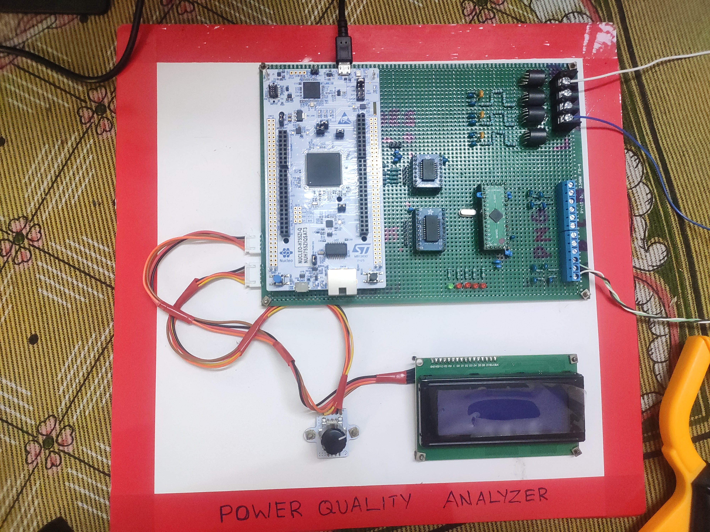
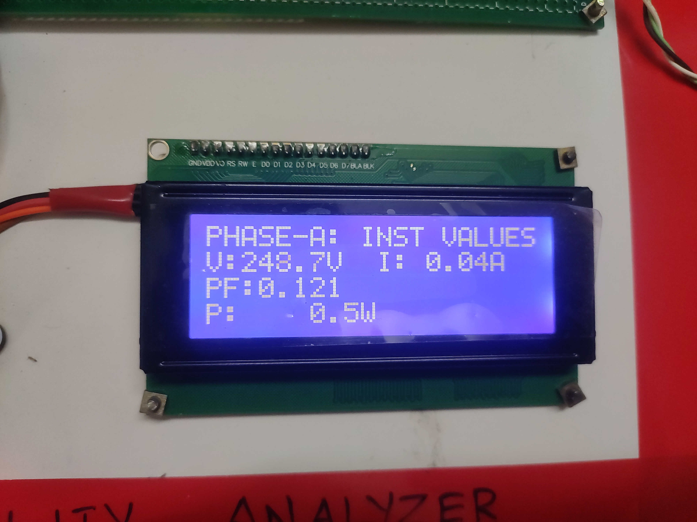

# ADE9000 Example Application

This example demonstrates how to use the **ADE9000 Energy Metering IC** with an **STM32H755** dual-core microcontroller.

The project has been developed and tested on the **NUCLEO-H755ZI-Q** development board and showcases a complete embedded energy metering pipeline, from waveform acquisition to real-time visualization on a PC.

---

## Features

- STM32H755 Dual-Core (CM7 + CM4) Example
- ADE9000 Initialization and Configuration
- DMA-based SPI Communication
- Waveform Buffer (WFB) Acquisition
- Burst Register Reads
- Real-time Parameter Computation
- Shared Memory Communication between CM7 and CM4
- UART Streaming of Waveform Data
- CRC16 Packet Verification
- Python-based Real-Time Visualization GUI

---

# Hardware Architecture

<p align="center">

</p>

The example hardware consists of two major sections:

- **High/Live Side**
  - ADE9000 Energy Metering IC
  - Voltage Conditioning Circuits
  - Rogowski Coil Current Conditioning Circuits
  - Crystal Oscillator
  - ADE9000 Reset & Debug Circuitry

- **Safe Side**
  - STM32H755 MCU
  - Display/User Interface
  - ESP8266 WiFi Module
  - Digital Isolation
  - Power Supply

---

# Reference Hardware

The analog front-end surrounding the ADE9000 is based on the official **Analog Devices EVAL-ADE9000-Shield** reference design.

Useful resources:

- **[EVAL-ADE9000-Shield Evaluation Board](https://www.analog.com/en/resources/evaluation-hardware-and-software/evaluation-boards-kits/eval-ade9000-shield.html)**
- **[UG-1098 – ADE9000 Evaluation Board User Guide](https://www.analog.com/media/en/technical-documentation/user-guides/ade9000-ug-1098.pdf)**
- **[ADE9000 Data Sheet](https://www.analog.com/media/en/technical-documentation/data-sheets/ade9000.pdf)**

---

# Software Architecture

<p align="center">

</p>

---

# Core Responsibilities

## Cortex-M7

The Cortex-M7 core is responsible for:

- Initializing the ADE9000
- Configuring SPI and DMA
- Capturing waveform samples
- Reading burst registers
- Computing:
  - VRMS
  - IRMS
  - Real Power
  - Reactive Power
  - Apparent Power
  - Power Factor
  - Peak Voltage
  - Peak Current
- Sending waveform packets over UART
- Updating shared memory for CM4

---

## Cortex-M4

The Cortex-M4 core demonstrates how processed data can be consumed by higher-level application software.

Current functionality includes:

- Receiving computed parameters from CM7
- ESP8266 WiFi communication
- MQTT Publishing
- LCD/User Interface demonstration

---

# UART Waveform Streaming

Besides computing electrical parameters on the STM32, the example also streams raw waveform data over UART for external visualization.

Communication parameters:

- **Baud Rate:** 921600
- Binary packet format
- CRC16 integrity check
- Continuous streaming

Packet format:

| Field | Size |
|--------|------|
| Header | 2 Bytes |
| Frame ID | 4 Bytes |
| Sample Count | 2 Bytes |
| IA Samples | 256 × int32 |
| VA Samples | 256 × int32 |
| CRC16 | 2 Bytes |

---

# Python Visualization Tool

A companion Python application is included to visualize waveform data streamed from the STM32 in real time.

The GUI was rapidly prototyped using **ChatGPT (vibe coded)** and serves as a demonstration tool for waveform visualization and signal analysis.

## Features

- Live Voltage Waveforms
- Live Current Waveforms
- Adjustable Gain
- Adjustable Time Scale
- Automatic Packet Synchronization
- CRC Validation
- RMS Computation
- Power Computation
- Power Factor
- Voltage THD
- Current THD
- Peak Voltage
- Peak Current
- Harmonic Spectrum
- Voltage Distribution Histogram
- Current Distribution Histogram

---

# GUI - Waveform Viewer

<p align="center">

</p>

---

# Harmonic Analysis

<p align="center">

</p>

---

# Hardware

<p align="center">

</p>


<p align="center">

</p>


---

# Building

Open the project using **STM32CubeIDE**.

Build both:

- CM7 Project
- CM4 Project

Flash both cores to the STM32H755.

---

# Running the Python GUI

Install the required packages:

```bash
pip install requirements.txt
```

Then run:

```bash
python visualizer.py
```

Update the serial port inside the script if required.

---

# Notes

This example is intended as a reference demonstrating:

- Dual-core firmware architecture
- High-speed SPI DMA communication
- ADE9000 waveform acquisition
- Electrical parameter computation
- Shared-memory communication
- High-speed UART streaming
- Desktop visualization using Python

It is **not intended to be a production-ready energy meter**, but rather a comprehensive reference implementation showing how the ADE9000 library can be integrated into an STM32H755-based embedded application.